# PDF Studio - Fast, Zero-Upload Client-Side PDF Tools

> **100% private, in-browser PDF manipulation suite. Zero server uploads. Works fully offline once loaded.**

[](https://vedantexists.github.io/pdf-studio/)
[](LICENSE)
[](#-100-in-browser-privacy)
[](#-automated-verification-suite)
[](#-benchmark-corpus--multi-reader-validation-phase-0)
[](#-audit-remediation--hardening-architecture)

🌐 **Live Studio**: [https://vedantexists.github.io/pdf-studio/](https://vedantexists.github.io/pdf-studio/)

---

## 🎬 Live Interactive Preview



---

## Complete 35-Tool Suite

### 1. Organize PDF
- **Merge PDF**: Combine multiple PDFs into a single document in any custom sequence.
- **Split PDF**: Extract all pages as separate PDFs (ZIP) or extract custom page ranges (e.g. `1-3, 5`).
- **Remove Pages**: Target and delete unwanted pages cleanly.
- **Extract Pages**: Pull selected pages into a standalone PDF.
- **Organize PDF**: Visual thumbnail grid to reorder, delete, and rotate individual pages with full desktop controls and mobile touch reordering (◀ / ▶) on viewports ≤900px.
- **Scan to PDF**: Capture multi-page documents directly using your mobile camera or desktop webcam with Otsu binarization and contrast presets.

### 2. Optimize PDF
- **Compress PDF**: In-memory stream compaction & metadata stripping reducing file size (>80% on image-heavy documents) while preserving readability.
- **Repair PDF**: Hierarchically resolves `/Root` outside stream bodies and synthesizes clean XRef tables with true Latin-1 decoding to recover broken PDFs.
- **OCR PDF (Beta)**: Local offline OCR via bundled Tesseract WASM + worker + language data. Injects an invisible searchable text layer using line/word bboxes with zero cloud uploads or CDN requests.

### 3. Convert to PDF
- **JPG / PNG to PDF**: Assemble images into a formatted PDF document with customizable margins and page sizes.
- **Word to PDF (Beta)**: Converts text, headings, paragraphs, and simple tables from Word (.docx). Does not support images, CSS, or complex layout.
- **PowerPoint to PDF (Beta)**: Converts slide titles, bullet points, and text from PowerPoint (.pptx) into 16:9 slides. Does not support images, shapes, or complex layout.
- **Excel to PDF (Beta)**: Converts tabular cell text from Excel (.xlsx) into a landscape grid. Does not support formulas, charts, or cell styling.
- **HTML to PDF (Beta)**: Converts text, headings, and simple tables from HTML. Does not support CSS layout, external fonts, or scripts.
- **Text to PDF**: Convert plain text or markdown notes into cleanly formatted, paginated PDF documents.

### 4. Convert from PDF
- **PDF to JPG / PNG**: Convert PDF pages into crisp high-resolution images (individual or ZIP).
- **PDF to Word (Beta)**: Extracts text and headings into Word (.docx) paragraphs. Does not support images or complex layouts.
- **PDF to PowerPoint (Beta)**: Extracts text into 16:9 presentation slides (.pptx). Does not support shapes, animations, or templates.
- **PDF to Excel (Beta)**: Extracts tabular text into Excel (.xlsx) sheets. Does not support charts, cell styling, or formulas.
- **PDF/A Metadata (Beta)**: PDF/A metadata only (not validated, not conformant). Appends XMP metadata schema (pdfaid) and sRGB OutputIntents without font subsetting or veraPDF ISO conformance validation *(see Archival Details below)*.
- **PDF to Text / Markdown**: Extract structured text, paragraphs, and headings from PDFs into clean Markdown or TXT.

### 5. Edit PDF
- **Edit PDF**: Add freehand drawing, highlighter, annotations, text, callouts, arrows, and shapes directly to PDF pages.
- **Rotate PDF**: Rotate all or specific pages 90°, 180°, or 270°.
- **Page Numbers**: Add clean page numbering across all pages with customizable placement and formatting.
- **Watermark PDF**: Add custom text watermarks with control over opacity, font size, angle, and color.
- **Crop PDF**: Adjust page dimensions and crop bounding boxes with interactive visual drag-handles.
- **PDF Forms**: Inspect and fill interactive form fields with options to save or permanently flatten.

### 6. PDF Security
- **Unlock PDF**: Decrypt open passwords and strip permissions restrictions in-memory.
- **Protect PDF**: Genuine standard AES-256 in-browser encryption requiring passwords across Adobe Acrobat, Chrome, Preview, and mobile.
- **Sign PDF**: Create drawn, typed, or uploaded electronic signature stamps onto document pages *(see Legal Transparency Note)*.
- **Redact PDF**: Permanently blackout sensitive numbers, private text, or confidential rectangular regions with raw content stream operator stripping.
- **Compare PDF**: Spot modifications and visual discrepancies between two PDF revisions side-by-side.

### 7. PDF Intelligence (Beta)
- **AI Summarizer (Beta)**: Extractive in-memory executive summary & bullet key takeaways using client-side sentence significance scoring (100% private, zero external model downloads or cloud APIs).
- **Translate PDF (Glossary)**: Local in-memory term and business glossary translation using built-in offline dictionaries (Spanish, French, German, Italian) with 100% client-side privacy and zero network egress.
- **PDF to Markdown**: Direct extraction of headings, lists, tables, and code blocks into structured Markdown.

---

## 🔒 100% In-Browser Privacy & Offline Guarantee

All processing happens entirely in client memory using WebAssembly and pure JavaScript (`pdf-lib`, `pdfjs-dist`, `jszip`).
- **Zero data retention**: Documents never leave your browser tab.
- **Zero external network egress**: All tools operate offline without calling third-party cloud APIs.
- **`server.js` is strictly an optional, local static development server**: It has zero API routes, zero storage, and performs no data handling—it simply serves HTML, CSS, and JS files over localhost.
- **Works fully offline once loaded**: All core engines and vendor libraries are bundled locally in `vendor/` without runtime CDN script dependencies.

---

## 🛡️ Technical Specifications & Transparency Disclosures

### 1. Password Protection (Real AES-256 In-Browser Encryption)
- **Standard**: Uses genuine ISO 32000-1 / PDF 2.0 **AES-256** encryption (`/V 5 /R 6 /AESV3`) with Web Crypto key derivation.
- **Cross-Reader Verification**: Encrypted PDFs are genuinely ciphered at the stream and string level. When opened in **Adobe Acrobat, Google Chrome, Mozilla Firefox, Microsoft Edge, Apple Preview, or mobile PDF readers (iOS/Android)**, the reader strictly demands the password before displaying pages or rendering content.
- **Configurable Permissions (P Value)**: Permission flags are built directly from the PDF specification bitmask. Defaults to all permissions allowed (`P = -4`). Individual permissions (printing, copying, modifying, annotating) can be toggled on or off explicitly from the Protect dialog.

### 2. Redaction Safety (Content Stream Operator Stripping)
- Unlike basic editors that simply place black visual rectangles over text (leaving the underlying text selectable and extractable), PDF Studio's `redactPDF` engine decompresses page content streams, strips or masks raw text operators (`Tj`, `TJ`, `'`, `"`) within the bounding box coordinates, and repacks the stream before drawing opaque blackout overlays.

### 3. Sign PDF: Visual Electronic Stamp vs. Cryptographic Certificate
> **⚠️ Legal & Technical Transparency Note:**
>
> The **Sign PDF** tool in PDF Studio creates an **Electronic Signature Stamp (e-Signature)**—a high-resolution visual signature graphic (drawn on canvas, typed with handwriting fonts, or uploaded as an image) baked directly into the document's page stream.
>
> - **What it is**: An electronic mark/overlay permanently rendered onto the PDF canvas.
> - **What it is NOT**: It is **not** a cryptographic PKI / X.509 digital signature (PAdES / Adobe Approved Trust List). It does not embed a private key digital certificate, mathematical cryptographic digest, or timestamp authority token.
> - **Legal Validity**: While electronic signature stamps are commonly accepted for informal contracts, internal approvals, receipts, and day-to-day forms, formal government filings, legal deeds, and regulated financial contracts may legally mandate certified cryptographic digital signatures. Always verify the compliance requirements of your jurisdiction and counterparty.

### 4. Office Conversions & PDF/A Conformance Disclosures
- **Office Conversions (Beta)**: Built on pure client-side OpenXML ZIP parsers (`docx`, `pptx`, `xlsx`) and lightweight HTML parsing designed strictly for text, headings, and simple tables without sending documents to third-party conversion servers.
  - **What is supported**: Text paragraphs, headings, bullet lists, simple tabular data grids, and basic formatting.
  - **What is NOT supported**: Images, CSS styling, complex floating layouts, header/footer drawings, formulas, charts, shapes, animations, external fonts, or JavaScript.
- **PDF/A Metadata (Beta)**: **PDF/A metadata only (not validated, not conformant)**. Appends the XMP metadata schema (`pdfaid`) and sRGB OutputIntents dictionary. It does not validate against ISO 19005-1, does not embed missing fonts or ICC profiles, and does not claim or guarantee ISO conformance under validators such as veraPDF.

---

## 🛡️ Remediation & Hardening Architecture (Phases 1, 2 & 3)

PDF Studio has undergone comprehensive multi-phase engine hardening to guarantee enterprise-grade data privacy, memory safety, and cross-platform UX without server dependence:

### Phase 1: Security & Core Engine Hardening
- **Deep Redaction Sanitization**:
  - Automatically sanitizes all page annotation dictionaries (`/Annots`), including hyperlinks (`/Link`), tooltips, and popup text intersecting redaction bounding boxes to prevent link leaks.
  - Recursively strips and clears interactive form field values (`/V`, `/DV`, `/AP`) intersecting blackout coordinates.
  - Performs deep traversal into nested Form `/XObject` content streams with Coordinate Transformation Matrix (CTM) tracking, stripping raw text operators (`Tj`, `TJ`, `'`, `"`) directly at the stream level so that no underlying sensitive text can ever be extracted, copied, or read.
- **Image Compression Color & Alpha Preservation**:
  - Automatic `/DeviceCMYK` channel conversion to sRGB before downsampling guarantees faithful color rendering and prevents color inversion (negative/neon artifacts) on print PDFs.
  - Preserves soft masks (`/SMask`) and PNG formats during compression to maintain alpha channel transparency.
  - Reachability graph sweeping identifies and purges unreferenced orphan image stream objects, achieving verified >80% file size reduction on image-heavy documents.
- **Modern PDF 1.5+ XRef Stream Resilience & Fast Repair**:
  - Detects PDF 1.5+ cross-reference streams (`/Type /XRef`) in `hasValidTrailer`, preventing false corruption repair passes on healthy modern PDFs.
  - Replaced quadratic space string allocations in `repairPDF` with zero-allocation byte slice indexing (`nonStreamSlices`).

### Phase 2: Offline Invariants & Performance
- **Local Bundled PDF Worker (Zero CDN Egress)**:
  - Configures `pdfjsLib.GlobalWorkerOptions.workerSrc = 'vendor/pdf.worker.min.js'` across all application entry points.
  - Completely eliminates runtime external CDN fallbacks (`cdnjs`, `unpkg`, `jsdelivr`) and 404 network errors, guaranteeing seamless functionality in air-gapped environments.
- **Compare PDF Memory Optimization & GPU Resource Cleanup**:
  - Stream-based per-page visual diffing bounds in-memory canvas caches (`maxDiffImages: 1`), preventing browser crashes and memory spikes on 50+ page documents.
  - Wrapped in `try ... finally` blocks with immediate canvas dimension zeroing (`canvas.width = 0; canvas.height = 0`) to actively reclaim browser backing store and GPU textures.
- **Honest Labeling & Transparent Disclosures**:
  - Explicit error handling with informative instructions when client-side OCR is invoked without the local Tesseract WASM engine loaded.
  - Re-labeled glossary translation as `Translate PDF (Glossary)` with prominent disclosures indicating offline dictionary term matching with zero network transmission.

### Phase 3: Integrity, Verification & Mobile UX
- **Robust Multi-Letter Spreadsheet Column Indexing**:
  - Replaced Latin1 char code arithmetic (`String.fromCharCode(65 + col)`) in `pdfToExcel` with static alphabet lookup supporting arbitrary column counts (A..Z, AA..ZZ), preventing non-ASCII corruption on wide data tables.
- **Consolidated Automated Verification Suite**:
  - Consolidated test runner in `package.json` covering core features, security redlines, offline invariants, format conversions, and adversarial stress tests with 100% pass rate.
- **Mobile Touch Reordering Controls (◀ / ▶)**:
  - Responsive touch reordering bar on Organize PDF page thumbnails for viewports `≤ 900px`.
  - Accessible 40px+ tap targets with `touch-action: manipulation` for instant response without double-tap delay, eliminating horizontal layout overflow on narrow mobile devices.

### Phase 4: Independent Security & Acceptance Audit Remediation
- **PDF Permission Flags & Configurable Protect Dialog**: Standard 32-bit permission bitmask construction from ISO 32000-1 Table 22. Defaults to all permissions allowed (`P = -4`) with explicit UI checkboxes for printing, copying, modifying, and annotating across both the workspace settings and modal dialogs, verified in headless browser with `qpdf --show-encryption`.
- **Repair Engine Catalog & Stream Length Resolution**: Hierarchically resolves genuine `/Root` Catalog dictionaries outside stream contents, enforces true Latin-1 byte-to-char mapping, and automatically recomputes desynchronized `/Length` dictionaries directly from `endstream` markers to recover genuine page text and pass `qpdf --check`.
- **Offline Bundled Tesseract WASM OCR**: Bundled local Tesseract.js WASM, worker, and English language data (`eng.traineddata`) under `vendor/tesseract/`. Eliminated all fake placeholder text. Searchable invisible text layer placed via line/word bounding boxes, strict error throwing when engine is missing in Node, and transparent `failedPages` tracking.
- **Truthful PDF/A Labeling**: Relabeled everywhere as "PDF/A metadata only (not validated, not conformant)" with all ISO conformance claims removed.
- **Hygiene & Strict CSP**: Self-hosted WOFF2 fonts (Caveat, Dancing Script, Great Vibes) under `vendor/fonts/`, enforced strict Content Security Policy (`connect-src 'none'`), thorough innerHTML XSS sanitization (including filename injection vectors), and verified zero runtime network egress.
- **Test Integrity & Dynamic CI Runner**: Dynamic test runner (`test/run_all.js`) executing all 28 test suites dynamically without hand-maintained lists, collecting pass/fail and assertion counts with non-zero exit on failure or zero assertions, running matrix on Node 20 and Node 22 in CI, and multi-reader validation using QPDF (`--check`), PDF.js, and PDFium.

---

## Quick Start

### Option 1: Open Live Web App
Open the deployed studio at **[https://vedantexists.github.io/pdf-studio/](https://vedantexists.github.io/pdf-studio/)**.

### Option 2: Open directly from disk
Open `index.html` directly in any modern web browser (Chrome, Edge, Firefox, Safari).

### Option 3: Run local development server
```bash
npm start
```
Then visit [http://localhost:3000](http://localhost:3000).

---

## 🧪 Automated Verification Suite
Run the 28-suite automated dynamic verification harness covering security redlines, offline invariants, memory lifecycles, and zero-network egress traps:
```bash
npm test
```
To run targeted test suites independently:
```bash
npm run test:core      # Core PDF operations and format conversions
npm run test:audit     # Forensic audit and E2E acceptance traps
npm run test:security  # Adversarial security, redaction, and cipher suites
```

### 📊 Benchmark Corpus & Multi-Reader Validation (Phase 0)
Run the 17-task benchmark harness across the 25-file standardized test corpus (`bench/corpus/`):
```bash
node bench/run.js
```
- **25 Standardized Corpus Fixtures**: Synthesized via `bench/generate_corpus.js` covering large page counts (220 pages), non-Latin typography (CJK, Cyrillic, Greek, Arabic), interactive AcroForms, extreme dimensions (A0 to 72x72 pt), encrypted documents, scan binarization, and vector alpha transparency.
- **Dual External Reader Validation**: Every output file is verified through both **QPDF** (`qpdf --check --warning-exit-0`) and **PDFium** (`pypdfium2`).
- **100% Passing Benchmark**: Verified 17/17 tasks passing QPDF and PDFium validation with zero structural corruption and full text preservation.
- **Negative Control Guard**: Verified via negative control tests that corrupt/malformed PDFs trigger an exit status of 1.
- **iLovePDF Manual Comparison Protocol**: Standardized evaluation protocol in `bench/ilovepdf_manual.md` for head-to-head manual quality tracking.
- Detailed technical specifications and results in [docs/PHASE0_FOUNDATIONS.md](docs/PHASE0_FOUNDATIONS.md) and [docs/BENCHMARKS.md](docs/BENCHMARKS.md).

---

## Repository Structure & Developer Notes
- `pdf_core.js`: Pure PDF manipulation logic powered by `pdf-lib` and WebCrypto.
- `app.js`: Presentation controller, drag-and-drop intake, mobile touch reordering, and thumbnail rendering via `pdfjs-dist`.
- `index.html` / `style.css`: Responsive dashboard grid, 6-column mega-menu navigation, and mobile touch reorder layout.
- `vendor/`: Self-contained vendor libraries (`pdf-lib.min.js`, `jszip.min.js`, `pdf.min.js`, `pdf.worker.min.js`, bundled Tesseract WASM, and self-hosted WOFF2 fonts).
- `test/`: Comprehensive dynamic test runner and test suites validating core features, security redlines, compression, and zero egress.
- `bench/`: Standardized 25-file benchmark corpus (`bench/corpus/`), corpus generator (`generate_corpus.js`), dual QPDF/PDFium runner (`run.js`), results ledger (`benchmark_results.md`), and iLovePDF comparison guide (`ilovepdf_manual.md`).
- `docs/`: Technical specifications, architectural foundations, and verification documentation.

---

## License
[MIT](LICENSE) © 2026 Vedant Kushwaha
